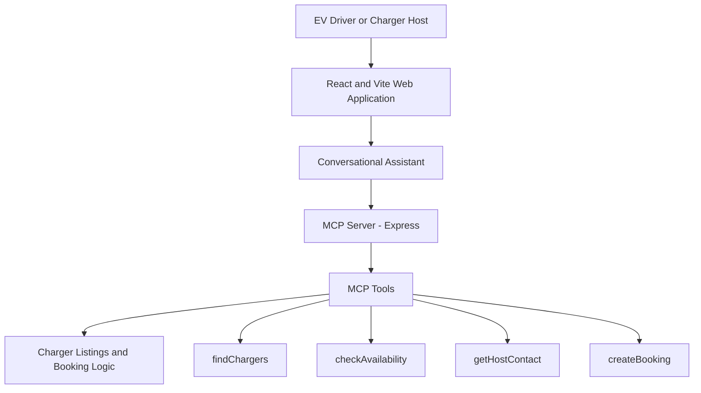
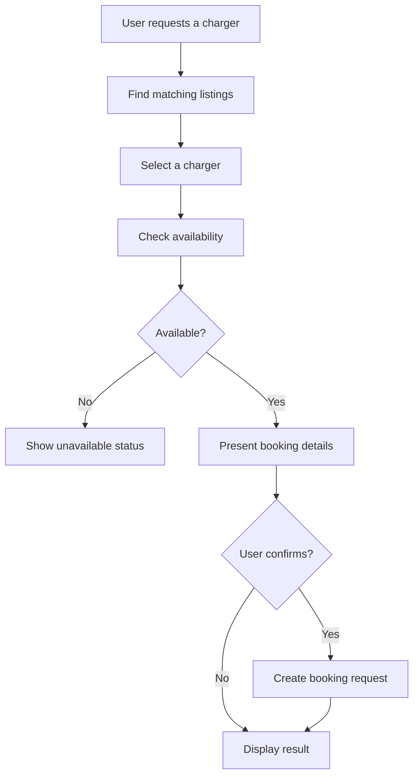

# WhatACharger ⚡
### Conversational EV Charging Discovery & Booking Platform

**WhatACharger** helps electric vehicle drivers discover charging options, check availability, connect with charger hosts, and initiate booking requests. It combines a React web application with an MCP server that exposes charging-related tools to an AI assistant.

**Live Demo:** https://what-a-charger-h439v26cp-sanika-dahiwals-projects.vercel.app  
**GitHub Repository:** https://github.com/SanikaDahiwal0015/WhatACharger

## 1. Problem Statement

EV drivers may experience range anxiety when they cannot easily find a suitable charging point, especially while travelling. At the same time, individuals and businesses with charging facilities may need a simple way to make them discoverable.

WhatACharger explores a conversational approach to charger discovery and booking, making it easier for drivers to find relevant listings and connect with hosts.

## 2. Key Features

- **Charger Discovery:** Browse charger listings and their details.
- **Conversational Assistant:** Ask natural-language questions about finding chargers.
- **MCP Tool Integration:** Access charging operations through Model Context Protocol tools.
- **Availability Checking:** Check the availability of a selected charger.
- **Host Contact:** Retrieve contact details associated with a charger listing.
- **Booking Requests:** Initiate a booking workflow.
- **Host Interface:** Manage charger listings through the website.

The Alexa+-inspired assistant is a simulation within the web application, not an official Alexa+ device integration.

## 3. Technology Stack

| Component | Technology |
|---|---|
| Frontend | React, JavaScript, Vite, CSS |
| Server | Node.js, Express |
| AI integration | Google GenAI SDK |
| Tool integration | Model Context Protocol (MCP) |
| Validation | Zod |
| Additional integration | Supabase client |
| Web deployment | Vercel |

## 4. System Architecture



**How it works:**

1. The driver opens the website and explores charger listings or uses the assistant.
2. The assistant interprets the user's request and, when connected, uses appropriate MCP tools.
3. The MCP server exposes the charging tools through the Model Context Protocol.
4. The tools perform the corresponding discovery, availability, contact, or booking operation.
5. The result can be presented to the user through the application.

*The diagram represents the intended application architecture. Actual connectivity depends on the assistant configuration and deployed server endpoints.*

## 5. MCP Tools

| Tool | Responsibility |
|---|---|
| `findChargers` | Find matching charger listings |
| `checkAvailability` | Check whether a charger is available |
| `getHostContact` | Retrieve the associated host's contact details |
| `createBooking` | Create a booking request |

These tools separate charging operations from the conversational interface, allowing an MCP-compatible client to invoke supported functionality.

## 6. Booking Workflow



This illustrates the intended user journey. Booking confirmation, availability validation, and persistence must be enforced by the actual implementation.

## 7. Installation and Local Setup

### Prerequisites

Install the following before starting:

- Node.js and npm
- Git
- Visual Studio Code or another code editor

### Step 1 — Clone the repository

Open PowerShell and run:

```powershell
git clone https://github.com/SanikaDahiwal0015/WhatACharger.git
cd WhatACharger
```

### Step 2 — Install frontend dependencies

Run from the project root, `WhatACharger`:

```powershell
npm install
```

### Step 3 — Start the frontend

```powershell
npm run dev
```

Open the local URL displayed in PowerShell, usually:

`http://localhost:5173`

Keep this terminal running.

### Step 4 — Open a second terminal

In VS Code, select **Terminal → New Terminal**. Then navigate to the project and MCP server:

```powershell
cd "$HOME\Downloads\WhatACharger\mcp-server"
```

If you cloned the repository to a different location, use that location instead.

### Step 5 — Install MCP server dependencies

```powershell
npm install
```

This installs the packages declared in `mcp-server/package.json`.

### Step 6 — Configure environment variables

Create or update `mcp-server/.env` using the variable names required by the server code. For example, if the code uses Gemini API access, configure the corresponding API key there.

Never commit `.env` files or expose API keys in frontend code or public repositories.

### Step 7 — Start the MCP server

```powershell
npm start
```

The server is configured for local development on port `3001`.

### Step 8 — Verify the server

Open a browser or use a third terminal and run:

```powershell
Invoke-RestMethod http://localhost:3001/health
```

The expected health response indicates that the MCP server is running.

The MCP endpoint used for local Inspector testing is:

`http://localhost:3001/mcp`

Keep the MCP server terminal running while testing tools.

## 8. Build and Lint

From the project root, run:

```powershell
npm run build
```

This creates the production frontend build in `dist`.

To run the project's lint checks:

```powershell
npm run lint
```

Resolve any reported errors before submitting.

## 9. Deployment

The frontend is deployed on Vercel:

**Live application:** https://what-a-charger-h439v26cp-sanika-dahiwals-projects.vercel.app

The MCP server is a separate service. Deploying the frontend does not automatically make the local MCP server publicly accessible. Assistant features that require MCP must be configured to reach an appropriately deployed server.

## 10. Project Structure

```text
WhatACharger/
├── src/                  # React application source
├── public/               # Public frontend assets, if present
├── mcp-server/
│   ├── server.js         # MCP server entry point
│   ├── package.json      # Server dependencies and scripts
│   └── .env              # Local environment variables (not committed)
├── package.json          # Frontend dependencies and scripts
├── index.html            # Vite HTML entry point
├── vite.config.js        # Vite configuration, if present
└── README.md             # Project documentation
```

## 11. Current Scope and Limitations

- Charger discovery depends on the listings and data sources configured in the project.
- Availability reflects the implemented data and logic; it should not be assumed to represent a live nationwide charger network.
- Booking requests should not be treated as confirmed reservations unless the configured implementation confirms them.
- Live AI and MCP functionality requires the necessary credentials, server connectivity, and configuration.
- The website is a prototype and should not be assumed to provide production payment processing.

## 12. Project Objective

WhatACharger demonstrates how conversational interfaces and MCP tools can make EV charger discovery and booking workflows more accessible to drivers and charger hosts.

**Built for the Amazon Developer Hackathon — Build, Ship, Shape.**